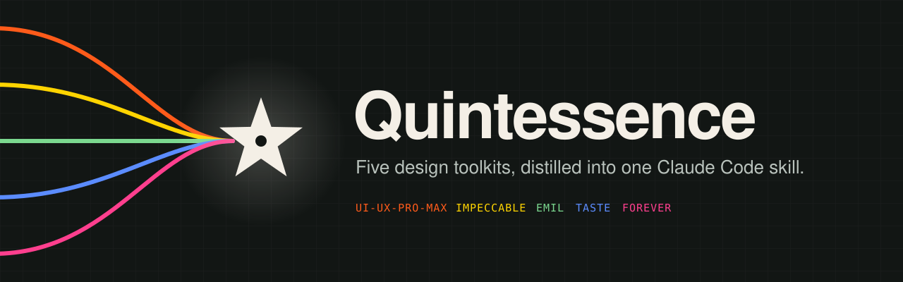
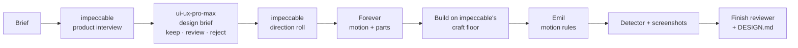
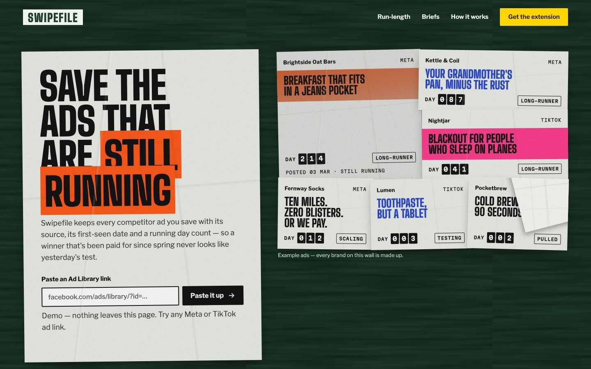

<p align="center">
  
</p>

<p align="center">
  <b>One skill. Five design minds. Interfaces that don't look AI-made.</b><br>
  <sub>For <a href="https://claude.com/claude-code">Claude Code</a> · macOS / Linux · Python 3 + Node 22 · no npm dependencies</sub>
</p>

---

Ask an AI agent for a landing page and you get the same page everyone gets: Inter, a purple gradient, a row of identical cards. **Quintessence** fixes that by routing every UI task through five open-source design toolkits, each doing the job it is best at, with explicit rules for who wins when they disagree.

```text
/quintessence build a landing page for my coffee subscription
```

## The five essences

| | Toolkit | What it brings |
|---|---|---|
| 🟧 | [**ui-ux-pro-max**](https://github.com/nextlevelbuilder/ui-ux-pro-max-skill) | Design-system generator and searchable database: 79 styles, 192 palettes, 74 font pairings, 119 UX rules, 22 stacks. Plus brand, banner, slides, tokens. |
| 🟨 | [**impeccable**](https://github.com/pbakaus/impeccable) | Product interview → `PRODUCT.md`, randomized direction rounds that dodge the category default, 24 design commands, a 61-rule anti-slop detector, finish-review and documenter agents. |
| 🟩 | [**Emil Kowalski's skills**](https://github.com/emilkowalski/skills) | Animation craft from Vercel/Linear: easing, duration, springs, what *not* to animate, motion reviews, native feel on phones. |
| 🟦 | [**taste-skill**](https://github.com/leonxlnx/taste-skill) | Anti-generic aesthetic directions (minimalist, soft/premium, brutalist), redesign checklist, no-truncation rules. |
| 🟥 | [**Forever AI Components**](https://github.com/isas1/forever-ai-components) | 604 self-contained animated HTML components, searchable offline, adapted into your design rather than pasted in. |

## How a build flows



When the toolkits disagree, Quintessence decides: **your brief wins**, impeccable's quality floor is the floor, Forever chooses *what* moves and Emil decides *how*, and ui-ux-pro-max's suggestions pass through a filter that drops anything another toolkit bans. Small jobs take the **quick path**: same quality bar, one pass.

## Built with it

<p align="center">
  
</p>

The [`test-landing/`](test-landing) page was built end to end with Quintessence for a fictional ad-library tool: a fly-posted street wall where ads that are still running stay up. It includes the full paper trail: [`PRODUCT.md`](test-landing/PRODUCT.md), the direction brief, [`DESIGN.md`](test-landing/DESIGN.md) and review screenshots.

## Install

```bash
git clone https://github.com/mahmoudpioneer/quintessence.git
cd quintessence
./update.sh        # fetches the five toolkits, builds, installs, smoke-tests
./test.sh          # 63 checks
```

This installs the skill to `~/.claude/skills/quintessence` and impeccable's four review agents to `~/.claude/agents`. Start a new Claude Code session and type `/quintessence`.

| Command | Does |
|---|---|
| `./update.sh` | Pull the latest toolkits, rebuild, reinstall |
| `./install.sh` | Rebuild and reinstall from the toolkits already fetched |
| `./test.sh` | Verify the install |
| `./uninstall.sh` | Remove the skill and the agents it installed |

## Use

| You type | Quintessence does |
|---|---|
| `/quintessence` | Shows the menu |
| `/quintessence build …` | Full pipeline: interview, direction round, build, motion, review, DESIGN.md |
| `/quintessence quick …` | One pass for a component, section or prototype |
| `/quintessence redesign` | Critique + audit, then refine or replace |
| `/quintessence audit src/app` | impeccable's a11y / performance / anti-pattern audit |
| `/quintessence animate the modal` | Forever for the motion, Emil for the craft |
| `/quintessence components loader` | Search the 604 Forever components |
| `/quintessence system "fintech app"` | Filtered design brief: palette, fonts, layout pattern |
| `/quintessence capture http://localhost:3000` | Full-page desktop + 390px mobile screenshots |

Or just describe the UI task. The skill triggers on its own.

## Privacy

Quintessence patches impeccable's launcher so it **sends no telemetry and runs no update check**. impeccable's direction step still fetches its world catalog from impeccable.style (it sends only the roll settings, nothing about your project); `export QUINTESSENCE_OFFLINE=1` keeps everything local at the cost of the catalog's challenger directions.

## Repo layout

```text
src/SKILL.md                 the router: routing, precedence, Motion budget, pipelines
src/scripts/design_brief.py  ui-ux-pro-max output → KEEP / REVIEW / REJECT
src/scripts/capture.mjs      headless-Chrome screenshots, no dependencies
src/modules/forever/         Forever wrapper + offline component search
build.sh · install.sh · update.sh · test.sh · uninstall.sh
test-landing/                example build with its full design paper trail
```

The toolkits themselves are fetched into `vendor/` at install time and never committed or modified, except for two documented patches (install paths, and impeccable's privacy defaults); see the generated `SOURCES.md`.

## Credits

Quintessence is glue and judgment; the craft belongs to the toolkit authors. ui-ux-pro-max, Emil Kowalski's skills, taste-skill and Forever AI Components are MIT licensed; impeccable is Apache 2.0. Each install bundles their licenses under `LICENSES/`. Quintessence's own code is [MIT](LICENSE).
